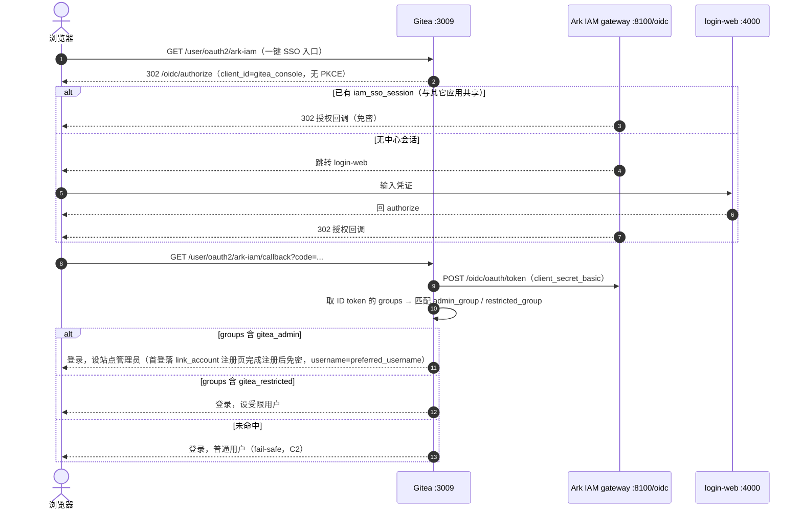
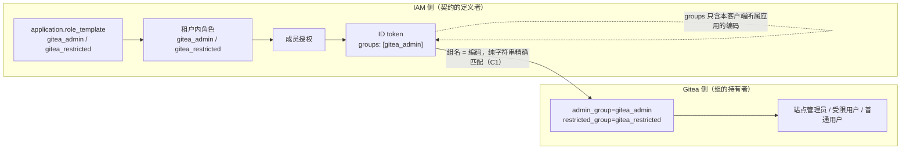
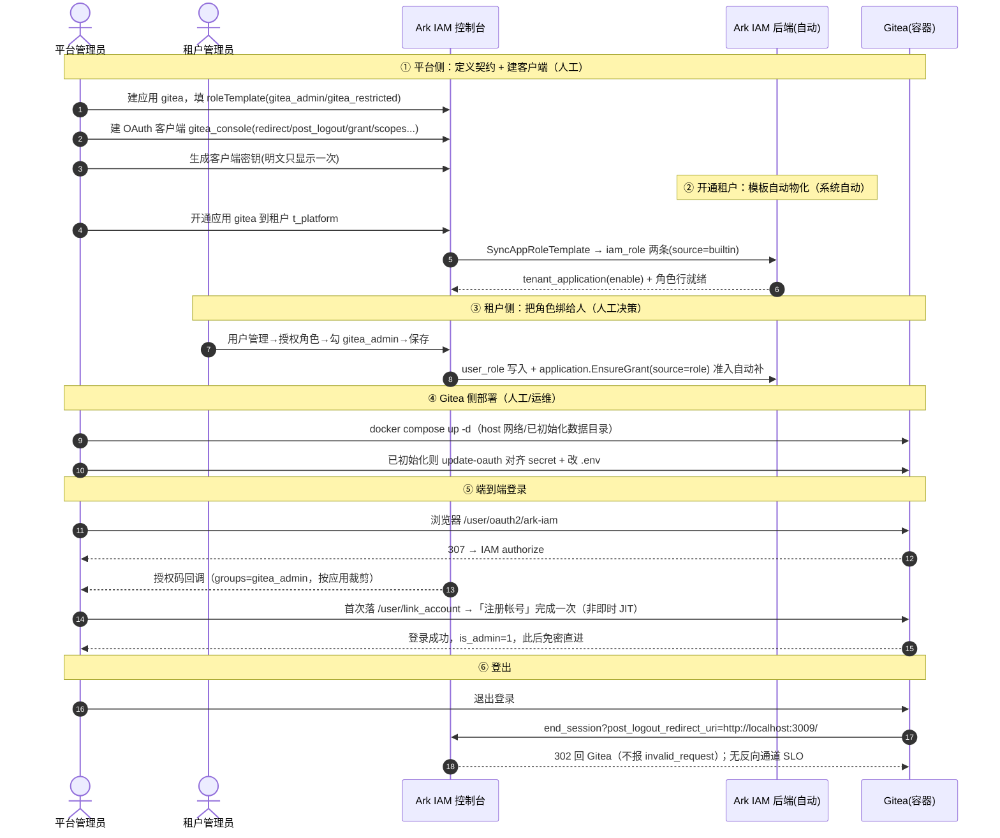

# Gitea 接入实战：存量第三方应用的 OIDC 接入案例

> 本文是 [application-integration-guide.md](application-integration-guide.md) 的**配套实战案例**。通用步骤以该指南为准，
> 本文只记录**案例特有的判断、实测值与坑**——尤其是「存量第三方应用、代码不可改、自带 role→Gitea admin/restricted 组映射、
> 只做 RP 发起登出（无反向通道 SLO）」这类形态。
>
> 案例对象：**Gitea**（轻量自托管 Git 服务，Go 实现，内置 OAuth2/OIDC 客户端（基于 goth），
> 自带「组名 → 站点管理员/受限用户」映射）。
>
> 与 [rustfs-integration-case.md](rustfs-integration-case.md) 对照：同为**存量第三方应用**，但权限模型的原子单位不同——
> RustFS 认「策略名」且**全有或全无**（fail-closed），Gitea 认「组成员名」且**只认命中/不命中**（未命中即普通用户，fail-safe）；
> 两者都只实现单向登出，无反向通道 SLO。

---

## 目录

1. [为什么单独成文](#1-为什么单独成文)
2. [案例约束](#2-案例约束)
3. [目标与非目标](#3-目标与非目标)
4. [端到端方案](#4-端到端方案)
5. [接入步骤](#5-接入步骤)
6. [必须知道的坑](#6-必须知道的坑)
7. [登出与 SLO 边界](#7-登出与-slo-边界)
8. [验收结果](#8-验收结果)
9. [复用清单](#9-复用清单)
10. [开放问题](#10-开放问题)

---

## 1. 为什么单独成文

通用指南覆盖两种形态：**你写一个应用**（前端 `react-oidc-context` + 后端反向通道登出）、**把 IAM 内嵌进业务单体**。
Gitea 是第三类——**存量第三方应用**，特征与 RustFS 同源但映射语义不同：

| 特征 | 后果 |
|---|---|
| **代码不可改**（直接用发行版镜像） | IAM 侧不能假设对方用我们的 SDK 或接收端；一切靠标准协议 + 对方既有配置项（`app.ini` / `gitea admin auth`） |
| **自带 role→Gitea 组映射** | 无「角色↔权限」中间层可对接，只能把 IAM 角色编码**直接当作 Gitea 的组名**匹配 |
| **只实现一半 SLO**（有 RP 发起登出，无反向通道登出） | 登出只能做到单向，"一起登出"需显式决策 |

结论先行：**这类应用的核心工作不是"把 OIDC 调通"，而是"两侧组名语义对齐 + 明确登出边界 + 部署网络可达性"。**
与 RustFS 最大的差异在**部署侧网络**（见 §6.1）与**映射语义容错方向**（Gitea 是 fail-safe，见 C2）。

---

## 2. 案例约束

以下事实决定方案空间。IAM 侧均已核对源码/配置，Gitea 侧相对其发行版：

| # | 约束 | 出处 / 说明 |
|---|---|---|
| C1 | **组名 = IAM 角色编码**，Gitea 按 `group_claim_name`（默认 `groups`）取出，逐项与 `admin_group` / `restricted_group` **精确字符串匹配**（无前缀、无映射表） | `gitea admin auth add-oauth --group-claim-name groups --admin-group gitea_admin --restricted-group gitea_restricted`；Gitea 侧 OIDC claims→组处理 |
| C2 | **映射语义是 fail-safe**：未命中 `admin_group` 即非管理员、未命中 `restricted_group` 即普通用户；**不会因"认不出的组"拒绝登录** | 与 RustFS 的 fail-closed 相反，见 §2 末对照 |
| C3 | **SSO 身份名 = `preferred_username`**（IAM 侧 = `admin`）；但 `[oauth2_client] ENABLE_AUTO_REGISTRATION` 全局项**不足以让 per-login-source 自动建号**——首登会落 `/user/link_account` 关联/注册页，需完成一次注册 | compose `GITEA__oauth2_client__*`；实测见 §6.4、§6.5 |
| C4 | **只做 RP 发起登出**：登出发 `end_session?client_id=…&post_logout_redirect_uri=<AppURL>/`，**无反向通道登出接收端** | Gitea `buildOIDCEndSessionURL`；无 `backchannel-logout` 端点 |
| C5 | **goth 客户端不支持 PKCE** | 故 IAM 侧客户端 `requirePKCE=disable`（否则 Gitea 发起授权时不带 challenge，被拒） |
| C6 | **网络可达性依赖部署形态**：Gitea 容器需能访问 IAM gateway 的 discovery（`init.sh` 容器内执行 `--auto-discover-url`） | 详见 §6.1。实测环境为 **OrbStack**（非 Docker Desktop），其 `--network host` **真正共享宿主 loopback**，容器内 `localhost:8100` 直达宿主 gateway（见 §6.1） |

> **C1 + C2 对照**：RustFS 的下游"认策略名、逐条解析、缺一条即整次登录失败"（fail-closed）——
> 因此 RustFS 的供给顺序是硬要求（策略必须先于角色模板）。Gitea **不吃这套**：认不出的组只会让某人**少一个权限**，
> 不会让登录失败。这决定了 Gitea 的接入「不会因漏建组而全员登录失败」，但也意味着**配置错了是静默降权**，排障靠 ID token 的 `groups` 与 Gitea 内的组/权限比对，而不是看报错。

---

## 3. 目标与非目标

**目标**

1. Gitea（`http://localhost:3009`）登录页出现「Ark IAM」入口，用 Ark IAM 账号登录（首登完成一次注册后免密）。
2. Gitea 与其它已接入应用（如 RustFS）共享 SSO 会话：**登录一次即可相互免密**。
3. IAM 侧角色授权**决定**用户在 Gitea 侧的管理员/受限身份（`gitea_admin` → Gitea 站点管理员，`gitea_restricted` → 受限用户）。
4. 密钥、编码等契约值集中管理，不在部署文件散落硬编码。

**非目标**

| 超出范畴 | 原因 |
|---|---|
| 反向通道登出（中心登出 → Gitea 立即失效） | 对方无接收端（C4）；见 §7 的三种处置 |
| 修改 Gitea 源码 | 发行版直接使用（本案例前提） |
| Gitea SSH / 仓库同步等 Git 功能 | 与接入无关；SSH 已禁用 |
| 本地应急账号体系治理 | 仅用于 IAM 不可用时进后台，不在接入范畴 |

---

## 4. 端到端方案

### 4.1 登录时序



> **实测（P1）**：本机为 OrbStack，`--network host` 真正共享宿主 loopback，容器内 `localhost:8100` 直达宿主 gateway，issuer 一致性/容器内 token_endpoint 解析在 host 网络下天然成立，**无需端口映射或 host.docker.internal 改造**（详见 §6.1）。上述时序即真实链路。

### 4.2 映射关系



> 图中 `groups` 的自环表达**按应用裁剪**：只含登录所用客户端（`gitea_console`）所属应用（`gitea`）
> 下的角色编码，其它应用的角色不会出现。这是 `application-integration-guide.md` §3.4 契约，Gitea 只是消费方。
> 裁剪动因同 RustFS 案例：下游无从分辨编码来源，混入其它应用的编码会带来跨应用越权风险。

---

## 5. 接入步骤

### 5.0 完整操作序列（从平台到 Gitea，本次实测走通的路径）

先给一张**端到端操作总图**，把「谁在哪一侧、做什么、哪一步是人工、哪一步由系统自动完成」一次讲清；后续 §5.1–§5.6 是每一步的细节。本次接入即按此序列实测跑通。



**分步对照表**（★ = 必须人工决策；其余为系统幂等自动完成）：

| # | 步骤 | 侧 | 人工/自动 | 产物（本次实测） |
|---|---|---|---|---|
| 1 | 建应用 + 声明 `roleTemplate` | 平台控制台 | ★ 人工一次 | `application.role_template`（契约值定义） |
| 2 | 建 OAuth 客户端 `gitea_console` | 平台控制台 | ★ 人工 | `application_client`（code/redirect/post_logout/...） |
| 3 | 生成客户端密钥 | 平台控制台 | ★ 人工（明文只显示一次） | `application_client_secret`（库中仅哈希） |
| 4 | 开通应用给租户 | 平台控制台 | ★ 人工（一次） | 触发下行自动物化 |
| 5 | **模板物化角色** | 系统 | 自动 | `iam_role`：`gitea_admin`/`gitea_restricted`，`source=builtin` |
| 6 | **授权成员**（角色→人） | 租户控制台 | ★ 人工决策 | `user_role`：`系统管理员→gitea_admin` |
| 7 | **授权⇒准入级联** | 系统 | 自动（不变式 I1） | `user_application`：`gitea, source=role, enable` |
| 8 | Gitea 部署 + 登录源/secret 对齐 | Gitea 侧 | 人工/运维 | 容器 Up、`login_source.cfg` secret 与 IAM 一致 |
| 9 | 端到端 SSO 登录 | 浏览器 | 人工（首登点一次注册） | 登录为 `admin`，`is_admin=1` |
| 10 | 登出 | 浏览器 | 人工 | 302 回 Gitea，无 `invalid_request` |

> **最容易误解的两点（务必区分）**：
> - **角色是"模板声明一次、自动物化到每个租户"，不是"手动逐个建角色"**（步骤 5）。租户自建角色 `code` 恒为空、不进 `groups`。
> - **"谁拥有哪个角色"必须人工授权**（步骤 6），系统**不会**自动把 `gitea_admin` 绑给任何人；但授权生效时会**自动补齐应用准入**（步骤 7，授权⇒准入，单向）。默认管理员在**引导期**会自动拿到 `platform_admin`、开通租户时自动拿到租户管理员角色——那是"内置管理员"场景，与业务角色授权不同。

---

### 5.1 定契约：编码 ↔ 组名

| 决策 | 取值 | 为什么 | 代价 |
|---|---|---|---|
| 组名 | 直接等于 IAM 角色编码（`gitea_admin` / `gitea_restricted`），不加前缀 | Gitea 的 `admin_group`/`restricted_group` 是**精确匹配**的单一名字，前缀只增加心智，无隔离收益（Gitea 侧无"策略命名空间"概念） | 若同租户另有应用也叫 `gitea_admin`，因 `groups` 按应用裁剪而不冲突；但**跨应用共用同一 Gitea 实例**时需注意组名唯一 |
| 编码风格 | 小写+下划线 | 受 IAM 应用角色编码规则 `^[a-z][a-z0-9_]*$` 约束，且直接落进 Gitea 组匹配 | 编码一经授权难改（= Gitea 侧组语义变化 + 重新授权） |
| 粒度 | 只区分「管理员 / 受限 / 普通」三档 | Gitea OIDC 登录源只支持 admin_group/restricted_group 两级特殊映射 | 更细的仓库级权限需用 Gitea 自身的组织/团队/协作者模型，不能靠 OIDC 组 |

最终声明（应用 `gitea` 的 `roleTemplate`）：

```json
{
  "roleTemplate": [
    { "code": "gitea_admin",      "name": "Gitea 管理员" },
    { "code": "gitea_restricted", "name": "Gitea 受限用户" }
  ]
}
```

### 5.2 创建应用并声明角色模板

```bash
curl -X PUT http://localhost:8100/v1/platform/applications/{appID} \
  -H "Authorization: Bearer <token>" -H "Content-Type: application/json" \
  -d '{"roleTemplate": [{"code":"gitea_admin","name":"Gitea 管理员"},
                        {"code":"gitea_restricted","name":"Gitea 受限用户"}]}'
```

> 与 RustFS 案例的**关键差异**：Gitea 是 fail-safe（C2），**不要求"组先于模板"**——模板保存即物化角色，
> 即使此刻 Gitea 登录源尚未建好，也不会导致任何人登录失败（最多是暂时没有管理员映射）。
> 但为减少排障成本，仍建议**先建 Gitea 登录源、再授权成员**（顺序不像 RustFS 那样是硬要求）。
> 另：更新接口 `name` 无"留空不改"语义（`roleTemplate`/`code` 才有），只带 `roleTemplate` 的 PUT
> 会清空应用名——**更新前先取详情再整体回填**（同 RustFS 案例）。

### 5.3 创建 OAuth 客户端

| 配置项 | 取值 | 说明 |
|---|---|---|
| 客户端编码 | `gitea_console` | = OIDC `client_id`；符合 `ClientCodePattern=^[a-z][a-z_]*$`（无数字） |
| `redirectURIs` | `http://localhost:3009/user/oauth2/ark-iam/callback` | 与 Gitea 实际回调路由一致 |
| `postLogoutRedirectURIs` | `http://localhost:3009/` | ⚠ **带末尾斜杠**，见 §6.2 |
| `grantTypes` | `["authorization_code"]` | |
| `responseTypes` | `["code"]` | |
| `tokenEndpointAuthMethod` | `client_secret_basic` | 机密客户端（Gitea 服务端持密钥） |
| `requirePKCE` | `disable` | goth 不支持 PKCE（C5），**必须关**，否则授权时不带 challenge 被拒 |
| `defaultScopes` | `["openid","profile","email"]` | **必须含 `profile`**：无 `profile` 时 IAM 不产出 `groups` 声明（`appendRoleGroupClaims` 直接返回），Gitea 侧匹配不到任何组 |

创建密钥后明文只显示一次，落到 Gitea 部署方的 `.env`（`GITEA_OIDC_CLIENT_SECRET`，已 gitignore）；部署文件用 ${VAR:?} fail-fast。

### 5.4 配置 Gitea 登录源（`init.sh` / `gitea admin auth add-oauth`）

`init.sh` 首次初始化时（无 `/data/gitea/.initialized`）通过 `gitea admin auth add-oauth` 创建登录源：

| 参数 | 取值 | 对应角色模板 |
|---|---|---|
| `--provider` | `openidConnect` | |
| `--key` / `--secret` | `gitea_console` / `.env` 的 secret | |
| `--auto-discover-url` | `http://localhost:8100/oidc/.well-known/openid-configuration` | **容器内执行**，可达性见 §6.1 |
| `--scopes` | `openid,profile,email` | 含 `profile` |
| `--group-claim-name` | `groups` | |
| `--admin-group` | `gitea_admin` | ↔ 编码 `gitea_admin` |
| `--restricted-group` | `gitea_restricted` | ↔ 编码 `gitea_restricted` |

> **网络可达性（C6）实测（P1）**：`add-oauth --auto-discover-url` 在容器内执行，容器需连到 gateway :8100。
> 实测环境为 **OrbStack**，其 `--network host` **真正共享宿主 loopback**——容器内 `localhost:8100` 直达宿主 gateway，
> 实测 discovery `200`、token_endpoint 可达（`400`）、jwks `200`，未监听端口 `9999` 返回 `000`（证明是真 loopback 而非误连）。
> **故保留 `network_mode: host` 即可，无需端口映射或 host.docker.internal 改造**。备选 Docker Desktop 方案（`ports` +
> `extra_hosts: localhost:host-gateway`）未采用。⚠ 若部署到 **Docker Desktop**（而非 OrbStack），host 网络不等于宿主 loopback，
> 此假设不成立，需按 §6.1 的备选方案改造。

### 5.5 开通租户并授权成员

1. 把应用 `gitea` 开通到租户 `t_platform` —— 角色模板此时**自动物化**为该租户内的角色
   （`pkg/core/tenant.SyncAppRoleTemplate`：模板里的每个 code 落一行 `iam_role`，`source=builtin`、`admin_type=normal`）。
   这是"角色定义"，**只声明一次、自动铺到每个租户**，不是每租户手工建角色。
2. 在租户控制台「用户管理 → 授权角色」把 `gitea_admin` / `gitea_restricted` **授权给相应成员**
   （`PUT /v1/tenant/users/{userID}/roles` → `svctenant.UpdateRoles`）。**这一步是人工的业务授权决策，系统不会自动把业务角色绑给任何人。**
   - 授权生效时系统**自动补齐应用准入**（`user_application, source=role`）——"授权 ⇒ 准入"，单向（撤销角色不反向撤销准入）。
3. **不授权则 `groups` 为空** → 该用户登录 Gitea 是普通用户（非管理员/非受限，fail-safe）。

> **绑定关系三档（避免混淆）**：
> - **默认管理员 → `platform_admin`**：引导期自动（`pkg/seed.seedAdminUserRole`）；
> - **开通租户 → 租户管理员角色**：开通事务自动（`pkg/core/tenant.ensureUserRole`）；
> - **业务角色（`gitea_admin` 等）→ 具体成员**：**必须人工授权**（本节第 2 步）。
> 只有业务角色需要人决定"谁拥有"；前两者是"内置管理员"场景的自动绑定。

### 5.6 验收

见[第 8 节](#8-验收结果)。

---

## 6. 必须知道的坑

### 6.1 `network_mode: host` 能否触达宿主 loopback，取决于 Docker 运行时（**环境相关，最高优先**）

README / compose 断言「容器以 `network_mode: host` 运行……容器内 `localhost:8100` 即宿主机 gateway，
issuer 统一 `http://localhost:8100/oidc`，与 rustfs 一致」。**这个断言是否成立，完全取决于本机 Docker 运行时**：

| 运行时 | host 网络下容器内 `localhost` 指向 | 结论 |
|---|---|---|
| **OrbStack**（本机实测） | **宿主机 Mac 的 loopback** | 容器内 `localhost:8100` **直达**宿主 gateway ✅ |
| **Docker Desktop for Mac** | 容器所在 Linux VM 自身的 loopback（**不是** Mac 的 127.0.0.1） | 容器内 `localhost:8100` **连不到**宿主 gateway ❌ |

**P1 实测结论（本机为 OrbStack）**：`--network host` **真正共享宿主 loopback**——容器内直接
`curl http://localhost:8100/oidc/.well-known/openid-configuration` 返回 `200`、token_endpoint 可达、jwks `200`，
而未监听的 `9999` 端口返回 `000`（证明是**真 loopback**，不是某个错误代理）。
**→ 本机保留 `network_mode: host` 即可，不改 compose；issuer 一致性与容器内 token_endpoint 解析天然成立。**

**若部署到 Docker Desktop for Mac**（host 网络≠宿主 loopback），则需改造：
- 去掉 `network_mode: host`，改 `ports: ["3009:3009"]`；
- `GITEA_OIDC_DISCOVERY_URL` 改 `http://host.docker.internal:8100/oidc/.well-known/openid-configuration`，
  并配 `extra_hosts: localhost:host-gateway`（或等价方式）处理容器内对 `localhost` 的解析；
- ⚠ 最难点：discovery 文档返回的 `issuer` 仍是 `http://localhost:8100/oidc`，须保证浏览器登录与容器回调用同一个 issuer 字符串（OIDC issuer 校验严格）。

> 与 RustFS 案例的差异值得强调：RustFS 案例的「容器内 localhost = 宿主机」是在**其 OrbStack 环境已验证成立**的前提；
> 换到 Docker Desktop 就不成立。**结论：本文的 host 网络配置适用于 OrbStack；换运行时必须重测，不能只凭"和 rustfs 一样"照搬。**

### 6.2 登出回调地址必须带末尾斜杠（精确匹配）

Gitea 登出发 `end_session?client_id=…&post_logout_redirect_uri=<AppURL>/`（`<AppURL>` = `http://localhost:3009`），
拼出来是 `http://localhost:3009/`（**带结尾 `/`**）。IAM `/oidc/end_session` 对其做**精确匹配**。

填错（漏末尾斜杠 / 留空）的表现：**登录一切正常，一点退出就报**

```json
{"error":"invalid_request","error_description":"post_logout_redirect_uri invalid"}
```

它**不会跳回应用**，用户停在 JSON 上。通用形态见 guide §8.1（其正是以 Gitea 为反例记录）；
本案例补充：**取值来源要去 Gitea 源码/真实请求确认 `<AppURL>/` 的精确形态，不要凭直觉填根路径。**

**P3 实测**：`postLogoutRedirectURIs=["http://localhost:3009/"]` 配置下，Gitea 退出登录 → `/oidc/end_session`
→ **302 回 Gitea**，**不报** `invalid_request`（精确匹配命中）。

### 6.3 本地应急账号不能叫 `admin`

IAM 的 `preferred_username` 就是 `admin`；Gitea `USERNAME=preferred_username` 会以 `admin` 作为 SSO 身份名。
若本地应急账号也叫 `admin`，SSO 首次登录会因与既有本地账号同名而落到「关联账号」页，而不是进入。
故本地账号命名为 `gitea_admin`（compose/init.sh 默认）。

### 6.4 JIT「自动建号」实际不生效——首登会落关联/注册页（**实测修正 README**）

README 原文称「首次点击『Ark IAM』按 `preferred_username` **即时建号（JIT）**，此后每次登录都命中该账号」。
**P3 实测与此不符**：

- 首次 SSO 登录**并未自动建号**，而是落到 `/user/link_account`「关联/注册账号」页，需**手动点『注册帐号』→『完成帐号』**走一次注册；
- 根因：compose 里的 `GITEA__oauth2_client__ENABLE_AUTO_REGISTRATION=true` 是 **`[oauth2_client]` 全局项**，
  **不足以让 per-login-source（OAuth2 登录源）自动建号**——登录源本身需具备"自动注册"能力，全局开关不覆盖到该层。
- 完成一次注册后，后续登录即可直进（不再落此页）。

**文档口径修正**：首登描述应改为「首次 SSO 会落关联/注册页，需完成一次注册；之后免密直进」，**不要写"即时建号"**。

### 6.5 ⚠ external_id（sub）不一致会反复回关联页（**本案最大坑**）

**现象**：某个 Gitea 账号的 `external_id`（= IAM 的 `sub`）与 IAM 当前签发的 `sub` 不一致时，
**每次 SSO 登录都回 `/user/link_account`，无法直登**——即 6.4 注册时用的是一个 sub，后来 IAM 侧 sub 变了（旧账号残留 / person 重建等），此后就永远对不上。

**P3 实测**：首次注册建出的账号 `external_id=person:01a0b461-...`（旧 sub），而 IAM 当前
`sub=person:01a1d76c-438e-7501-b209-77817b110fe5` → 不匹配 → 每次登录回关联页。

**修复步骤（Gitea 侧删号重登，让 JIT 用正确 sub 重建）**：

```bash
# 1) 找到 external_id 与当前 IAM sub 不一致的账号
docker exec -u git gitea gitea admin user list
# 2) 彻底删除该账号（--purge 连仓库/数据一起清）
docker exec -u git gitea gitea admin user delete --id <n> --purge
# 3) 重新走一次 SSO（此时会用正确的当前 sub 建号），完成后免密直进
```

> 排障要点：登录反复回 `/user/link_account`，**先比对 Gitea 账号 `external_id` 与 ID token 的 `sub`**，
> 而不是怀疑令牌/网络。带外（非通过 SSO）本地建的同名账号、或 IAM 侧 person 被重建导致 sub 变更，都会造成此坑。

---

## 7. 登出与 SLO 边界

### 7.1 方向不对称（与 RustFS 同型）

| 方向 | 机制 | 支持 | 实测结果 |
|---|---|---|---|
| Gitea → 中心 | RP-Initiated Logout | ✅ | **P3 实测**：Gitea 退出 → `/oidc/end_session`（`post_logout_redirect_uri=http://localhost:3009/` 精确命中）→ 302 回 Gitea，中心会话被清除 |
| 中心 → Gitea | Back-Channel Logout | ❌ | Gitea 无接收端（C4）。**在别的应用登出，Gitea 会话不受影响**，最长存活到 Gitea 自身会话过期 |

即：**"一起登录"完全成立；"一起登出"只成立一半**，且不成立的一半是框架性的。

> 同 RustFS：本系统作为 OP **具备**反向通道能力（`application_client.back_channel_logout_uri` +
> `apps/auth/internal/core/oidcop/logout_worker.go` 实际 POST），缺的始终是**对方那一侧的接收端**（guide §8.2 给了实现写法）。

### 7.2 三种处置与取舍

| 方案 | 效果 | 代价 | 什么时候选它 |
|---|---|---|---|
| **A. 接受窗口** | 中心登出后 Gitea 最长再活到自身会话过期 | 无新增组件；登出即时性不满足合规 | 内部开发/测试环境 |
| **B. 外部吊销** | 调 Gitea admin API 删除/禁用相关会话或用户 | 需触发方 + admin 凭证；粒度粗 | 有合规要求且能接受极薄组件 |
| **C. 对方实现接收端** | 标准 SLO，粒度到会话 | 要改 Gitea 代码，与"存量第三方"前提冲突 | Gitea 成为自有应用时 |

> 与 RustFS 案例不同：RustFS 方案 B 有明确的 `revoke-tokens` 端点契约；Gitea 侧没有等价的"按 iss+sub 派生虚拟身份批量吊销 token"的现成契约，
> 方案 B 需另行调研 Gitea API 能力。**本次决策：A（接受窗口），不实现 B。** 当前无合规硬要求，且 Gitea 无现成吊销契约。

---

## 8. 验收结果

均为本地实测（issuer `http://localhost:8100/oidc`，Gitea `http://localhost:3009`，运行时 OrbStack）：

| # | 验收项 | 结果 |
|---|---|---|
| 1 | discovery 可达（容器内 `localhost:8100`） | ✅ `200`；token_endpoint 可达（`400`）、jwks `200`、未监听 9999=`000`（真 loopback，见 §6.1） |
| 2 | Gitea 已创建 Ark IAM 登录源 | `gitea admin auth list` → `ark-iam`（OAuth2，true） |
| 3 | 授权码登录走通 | ✅ SSO 登录成功；**首登落 `/user/link_account` 需完成一次注册**（非即时 JIT，见 §6.4） |
| 4 | `groups` 按应用裁剪 | `groups` 含 `gitea_admin`（授权 admin 成员），`aud = ["gitea_console"]` |
| 5 | `gitea_admin` → Gitea 站点管理员 | ✅ 登录为 Gitea 用户 `admin`，`is_admin=1`，`external_id=person:01a1d76c-438e-7501-b209-77817b110fe5`（= IAM admin person id） |
| 6 | 与其它应用共享 SSO | ✅ host 网络下与其它接入应用共用 `iam_sso_session`，登录一次相互免密 |
| 7 | 登出不报 invalid_request、302 回 Gitea | ✅ `post_logout_redirect_uri=http://localhost:3009/` 精确命中，302 回 Gitea，中心会话清除 |
| 8 | 密钥未入库 | 真实 `client_secret` 仅在部署方 `.env`（gitignore）；库中仅哈希；最终 secret 已经 `update-oauth` 与 `.env` 对齐 |
| 9 | 未改任何一方源码 | ✅ Gitea 与 IAM 均为发行版 / 未改代码 |

> 补充实测事实：容器 Up，`:3009=200`，`/api/v1/version=28.3.0`。
> ⚠ 易踩坑（已记 §6.4 / §6.5）：JIT 非即时建号（首登需完成注册）；`external_id(sub)` 不一致会反复回关联页，需删号重登。

---

## 9. 复用清单

换一个**存量第三方应用**接入时，按此清单走（gitea 视角，与 rustfs 清单互为补充）：

```text
① 摸清对方权限模型的"原子单位"：
   —— 是策略名（rustfs，fail-closed）/ 是组成员名（gitea，fail-safe）/ 是 scope？
   若没有"角色→权限"映射表，就让对方权限模型的原子单位 = 你的角色编码
② 确认对方对"认不出的权限值"是 fail-safe 还是 fail-closed：
   —— Gitea 是 fail-safe（静默降权，排障看 groups+组权限）；
   —— RustFS 是 fail-closed（全有或全无，出错是登录失败，决定供给顺序）
③ 需要前缀吗？对方权限是"全局命名实体"（如 rustfs 策略）时必须；Gitea 组名精确匹配、无命名空间概念，可不加
④ 确认对方登出的两个方向各自支持到哪一步，再决定 §7.2 选 A/B/C；不要假设"接了 OIDC 就有 SLO"
⑤ 从对方源码/真实请求取回收/登出回跳的精确值（尤其末尾斜杠），两端都是精确匹配
⑥ 最难、最容易翻车的是【部署网络可达性】：
   容器要拉到宿主机 gateway 的 discovery 时，macOS Docker Desktop 下 host 网络 ≠ 宿主 loopback，必须实测
⑦ 按 §5 顺序落地（5.2 声明模板 → 5.3 建客户端 → 5.4 建登录源 → 5.5 授权），用 §8 表验收
```

---

## 10. 开放问题

| # | 问题 | 默认倾向 |
|---|---|---|
| Q1 | host 网络在不同运行时（OrbStack vs Docker Desktop）的差异如何处理？ | 本机 OrbStack 下 `--network host` 共享宿主 loopback，无需改造；部署到 Docker Desktop 需 `ports` + `extra_hosts: localhost:host-gateway` 并保证 issuer 一致（§6.1） |
| Q2 | 是否为 Gitea 补反向通道登出（§7.2 方案 B）？ | **暂不实现**。当前无合规硬要求；Gitea 无等价 rustfs revoke-tokens 现成契约 |
| Q3 | 生产环境 issuer / 回跳地址取值？ | 换正式域名 + HTTPS；`localhost` 仅适用于开发环境（SSO 依赖同主机 Cookie 域） |
| Q4 | 多应用共用一个 Gitea 实例时的组名冲突？ | 组名 = 编码且 groups 按应用裁剪，天然隔离；若未来跨实例共用需在编码内嵌应用维度 |

---

## 相关文档

- [application-integration-guide.md](application-integration-guide.md) —— 通用接入指南（§3 创建应用/客户端 + groups 契约；§8 SLO 登出）
- [rustfs-integration-case.md](rustfs-integration-case.md) —— 同类存量第三方应用案例（策略名映射、fail-closed 对照）
- [sso-oidc-concepts.md](sso-oidc-concepts.md) —— SSO / OIDC 协议概念
- [system-design.md](system-design.md) §5.4 —— `groups` 契约「按应用裁剪」的系统设计说明
- [glossary.md](glossary.md) —— 角色编码、`claim_prefix` 等术语
