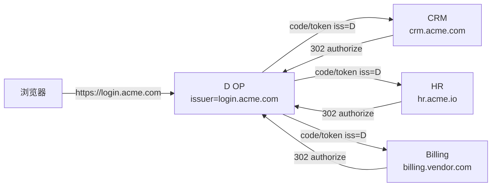
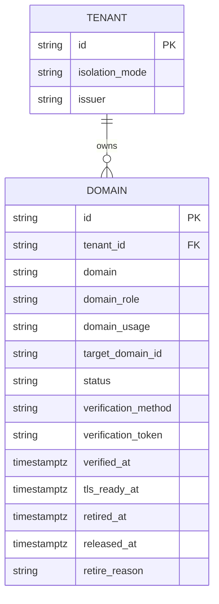
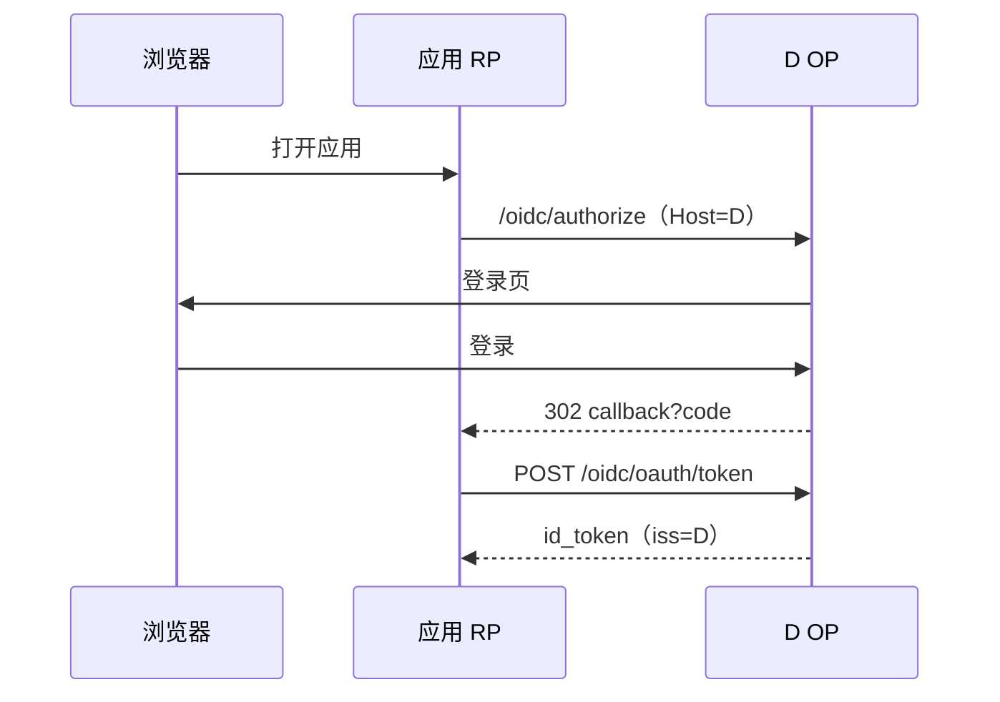

# 租户域名与多 issuer 设计（P0 修订版，待复审）

> 状态：评审中（**P0 冻结，spike 输入，未开工**）｜ 实施状态：待实施，不改代码 ｜ 作者：Ark IAM 架构组 ｜ 评审人：Codex、队友评审、平台/安全负责人 ｜ 拍板人：产品负责人 ｜ 最后更新：2026-11-27
>
> 产品决策：自定义域名目标 = **A（每租户 issuer / 自定义域即登录宿主）**；D（dedicated）与 S（shared）分级，一个 tenant 只能属于一个 tier。
>
> **P0 范围收敛**：只接**新建 D 租户**；不做 S↔D、不做 D→D 换主域、不做 S tier 改造、不做 router、不做 branded、不做共享控制台。P1/P2 的边界见 §9，不混入 P0 验收。

## 0. P0 结论（先看这一页）

| 维度 | P0 结论 |
|---|---|
| 目标 | 新建 D 租户：一个 primary 自定义域 + 一个 issuer；登录、cookie、`iss` 都在租户域 |
| 域名角色 | `primary`（1 个 active）/ `alias`（0..N，302 到 primary）；`branded` 不在 P0 |
| 应用域 | 只做 `application_client.redirect_uris`；无 `app_id` 维度 |
| 多应用不同主域 | 共用租户 primary issuer；一个 OP 登录，各应用会话独立 |
| 域名状态机 | `draft → verified → tls_ready → active → disabled → retired → released`；未 active 不作为 issuer |
| 权威事实源 | `iam_domain` 的 primary 行是 host 事实源；`iam_tenant.issuer` 是同事务派生缓存；**不新增 tenant 主域列** |
| 租户生命周期 | `provisioning` / `active` / `suspended`；D 新建为 provisioning，primary activate 后 active；offboard 置 suspended 并清空 issuer |
| 释放 | `released` 是终态；`iam_tenant.issuer` 在 offboard 清一次，release 只校验为空；alias 释放不动 tenant；host 可重新登记 |
| 管理台入口 | 新增 `iam_console_binding`：Host → 租户/issuer/client/audience/redirect_uri；`/config.json`、`/v1/auth/*`、`/v1/tenant/*`、back-channel 都读同一绑定 |
| 并发 | tenant 级 advisory lock + `SELECT ... FOR UPDATE`；唯一索引只兜底，不当状态机 |
| 签发门禁 | authorize/token/refresh 前读权威状态/epoch；`disabled/retired/issuer 变更` 立即拒绝新签发，不靠 host 缓存 |
| 部署拓扑 | **一个 auth/tenantadmin 服务承载多个 D host**；D 管理台是每个 D host 的固定配置 SPA；platformadmin 只在平台 host。`/oidc/*`、`/v1/auth/*`、`/v1/tenant/*`、`/config.json`、back-channel 全部按 Host 解析 issuer |
| D 管理台 | D 管理台 SPA 固定 D issuer/client；中央平台控制台固定平台 issuer；后端按 Host 验 D issuer，不做“多 issuer 共享控制台” |
| cookie | D 默认 **host-only**；登录 UI 与 auth 同 origin；拆 `login./auth.` 子域才用父域，且需安全评审 |
| client | `application_client` 增加 `issuer`，唯一 `(issuer, code)`；所有按 code 的查询都带 issuer |
| session/登出 | session/refresh/logout 记录带 `issuer+tenant+sid`；D 关闭无 sid 的 person 回退；`/logout` 当前 issuer，D host `/logoutAll` 410；平台 host 保留全局 |
| 迁移 | **P0 不迁移**；P0.5/P1 再做 S↔D、D→D 换主域；P2 才做双 issuer 兼容窗口 |
| 工期 | P0 试点 **18–25 人日**；3 个 spike 通过后再锁生产排期 |

**Gate 1–3 收敛（本轮）**

| Gate | 决策 |
|---|---|
| G1 部署/信任 | 一个 auth/tenantadmin 服务、多 D host；`/oidc/*`、`/v1/auth/*`、`/v1/tenant/*`、`/config.json`、back-channel 按 Host 解析 issuer；D 管理台是每 D 固定配置 SPA；平台控制台只在平台 host |
| G2 client | `application_client` 增加 `issuer`，`(issuer, code)` 唯一；create/update/seed 显式写 issuer；删除全局 `code` unique；所有 code-only 查询带 issuer |
| G3 状态机 | D 租户 onboarding 为 `provisioning`；active D 恰一 active primary；`tls_ready` 可取消；primary 只能经 `offboard` 停用/退役；alias `retired→released`；`released` 是显式状态；email-only 可跳过 tls_ready |

## 0.1 P0 实施契约（细则）

**冻结说明**：三份契约与本文已冻结为 spike 输入；冻结后不再接受整轮 review。任何变更必须由 S1–S3 spike 证据 + 一条 ADR 驱动，避免继续在文档层反复收敛。


P0 的落地细节拆成三份子契约；与本文冲突时，以子契约为准：

| 契约 | 覆盖 |
|---|---|
| [p0-host-binding-contract.md](p0-host-binding-contract.md) | Host × 路由矩阵、`iam_console_binding` 生命周期/作用域、平台 seed、D 启用、未知 Host、basePath、ProcessAll Host 白名单 |
| [p0-tenant-lifecycle-contract.md](p0-tenant-lifecycle-contract.md) | 租户 `provisioning/active/suspended`、D onboarding/取消/offboard、域名状态机、D console client 收尾、host 重登记 |
| [p0-issuer-context-contract.md](p0-issuer-context-contract.md) | issuer 在 OP/Gin 的传递、`pkg/oidcctx`、refresh/session 列、`/logout`/`/logoutAll`/`end_session`、offboard 撤销 |

**P0 明确不做**：S↔D/D→D 迁移、S tier/router、branded/多品牌、共享 RP 多 issuer、每租户 keyset、DNS/证书自动化、跨 issuer 全局登出。

## 决策追溯（决策 ↔ 需求）

| 决策 ID | 决策 | 挑战点 | 承接需求 | 备选 | 验证手段 | 状态 | 置信度 |
|---|---|---|---|---|---|---|---|
| D1 | A：每 D 租户独立 primary issuer | C1 | R1 登录、R2 多应用 | B 单 issuer + 发现 | AC-1/AC-2 | Accepted | 高 |
| D2 | P0 只接新建 D，不做迁移 | 按标准做法（范围裁剪） | R3 首发 | P0 含迁移 | P0 范围审计 | Accepted | 中 |
| D3 | 单状态机替代 `verification_status` | C1 | R4 域名生命周期 | 双字段 | AC-9 | Accepted | 高 |
| D4 | `iam_domain` 是事实源，`issuer` 是缓存 | C2 | R5 一致性 | 三处双写 | 启动/写后断言 | Accepted | 高 |
| D5 | D 管理台固定 issuer，共享控制台放 P1 | C3 | R6 D 管理 | 共享多 issuer | AC-8 | Accepted | 中 |
| D6 | host-only cookie + issuer session | C1 | R7 SSO | 父域 cookie | AC-7 | Accepted | 高 |
| D7 | `application_client (issuer, code)` | C2 | R8 客户端隔离 | 全局 client | AC-6 | Accepted | 高 |
| D8 | P0 共享 keyset 仅试点，D GA 前每租户 | 按标准做法（风险接受） | R9 密钥 | P0 每租户 | 安全评审 | Accepted | 中 |

## 挑战点

1. **C1 域名 active/issuer 与多副本一致性**：域名状态、host 解析缓存、签发门禁是三套路径；停用/退役必须同步拒绝新签发，不能只靠 60s 缓存。失败不可逆（已发 token），所以 P0 把“签发门禁”从 host 缓存里独立出来。
2. **C2 平台代租户写域名的事务/作用域**：`iam_domain` 是 tenant-scoped，`iam_tenant` 是 skip 表；同一事务里两种作用域语义，漏一次 `ExplicitTenantContext` 就会静默 0 行/写错租户。P0 统一走 `pkg/core/tenantdomain` + tenant 行锁。
3. **C3 D 管理台拓扑**：D issuer 与平台 issuer 是两套信任；共享控制台多 issuer 会把 P0 从“固定 issuer”推到“按请求分发 verifier + 登出接收端”。P0 选独立固定入口，把共享控制台放 P1。

> 其余按标准做法：迁移延后（P0 只接新建 D）、共享 keyset 试点、host-only cookie、未知 Host 拒绝，均在 §9/§10 给出边界，不单列为挑战点。

## 2. 主流对照与备选方案

| 方案 | 做法 | 结论 |
|---|---|---|
| A per-tenant issuer | 每租户自定义域 + 独立 issuer/cookie | **P0 采用（D）** |
| B 单 issuer + 域名发现 | 中央 issuer + `organization`/`domain_hint`/邮箱域 | S 保留，P1 再做 |
| 单 issuer + 别名 + ticket | 别名 302 中央 + 签名 hint | 否决：非主流、无硬边界 |
| 每应用一个 issuer | per-app issuer/cookie | 否决：按应用膨胀，SSO 断 |
| 每租户独立 OP 实例 | 每租户一套 IAM | 仅超大客户，P2 以后 |

**主流对照口径**：厂商能力只证明“某一层”，不是机制等价。

- Auth0 custom domain / Okta custom URL domain / Entra External ID：可证明 custom domain 登录宿主/issuer；Auth0 Organizations 仍只有 tenant 级一个 custom domain，per-org 域名需多 tenant；Okta multibrand 默认 3 域、可申请到 200，不等于物理凭证隔离。
- Cognito custom domain：主要是 managed login 端点，issuer/JWKS 可能仍在 Cognito 域，不能直接等价“每域 issuer”。
- Salesforce My Domain：per-org 登录宿主，discovery issuer 可能仍是 `login.salesforce.com`。
- Auth0 Organizations / WorkOS / Entra `domain_hint`：中央登录 + 组织发现；WorkOS 主要是路由/验证，不是 D/S 迁移标准。

**结论**：D 与 S 都是主流，但必须**分级租户 + router 分层**；P0 只做 D，S/router 放 P1。一个 tenant 不能同时 D+S；应用域只做 `redirect_uri`。

## 3. P0 目标模型

### 3.1 D 租户

| 项 | P0 规则 |
|---|---|
| primary | `tenant.status=active` 的 D 租户恰一个 active primary；`provisioning`/`suspended` 为 0；primary 的 `usage` 必须是 `login`/`both` |
| issuer | `https://<primary-host><basePath>/oidc`；`basePath` 是部署挂载前缀（空或 `/iam`，**不含 `/oidc`**），OP 端点为 `<basePath>/oidc/*`，登录 SPA 为 `<basePath>/login`；不在代码写死 |
| alias | 0..N；只 302 到 primary；不签 token；需要 TLS |
| 登录页 | 与 auth 同 host（默认 `login.acme.com`）；SPA 用运行时配置，`frontendLoginURL` 按 Host 派生 |
| cookie | host-only；不写 `Domain`；拆子域才用父域 |
| 应用 | 所有应用注册 `redirect_uri`；issuer 都是该租户 primary issuer |
| 管理台 | D 管理台固定 D issuer/client；中央平台控制台固定平台 issuer |

**P0 登录拓扑**



### 3.2 域名状态机

| 状态 | 含义 | 是否解析/签发 |
|---|---|---|
| `draft` | 已占 host，未验证；不建 TLS | 否 |
| `verified` | DNS TXT/人工域控证明通过；`verified_at` | 否 |
| `tls_ready` | 证书就绪；`tls_ready_at` | 否 |
| `active` | 唯一可用态；primary 可签发；login/both alias 可 302；email-only alias 仅登记，P0 不发现/不路由/不 302/不签发 | 是（email-only 不签发） |
| `disabled` | 停止新签发/解析；可回到 active | 否 |
| `retired` | 墓碑；host 仍占用；协议请求 400/404 | 否 |
| `released` | 隔离期满/审批后软删；host 可重新登记 | 否 |

**租户生命周期**

- 新建 D：`tenant.status=provisioning`，primary 从 `draft` 开始；verify → tls_ready → activate 后，同事务把 `tenant.status` 置为 `active`。
- active D：恰一个 active primary；未 active 的域名不解析、不签发。
- offboard（P0 唯一 primary 停用入口）：平台管理员执行；`tenant.status=suspended`，primary 同事务 `active → disabled`，清空 `iam_tenant.issuer`、`domain_epoch+1`，停新签发、撤 session/refresh；之后才可 retire/release。
- P0 不做 primary 更换；primary 退役只允许在 tenant offboard 之后。
- 租户状态最终枚举：`provisioning`（D 建租中）、`active`、`suspended`（offboard 后）；代码 `NormalizeTenantStatus` 的语义定为：**空=未指定**（普通 create→active、dedicated create→provisioning、update→保留原值）；非空非法→`101212`；**不得回退 active**。
- 白名单只保留一处，`PageList`/前端 types/glossary/system-design/api-reference 同步；`PUT/DELETE /v1/platform/tenants` 对 D 增加守卫，状态只能经 offboard 变。
- offboard：`tenant.status=suspended`、primary `active→disabled`、清空 `iam_tenant.issuer`、`domain_epoch+1`、撤销 session/refresh；之后 primary 可 retire/release。

**域名迁移矩阵**

| 对象 | 动作 | from → to | 守卫 |
|---|---|---|---|
| primary | verify | draft → verified | DNS TXT/人工域控证明 |
| primary | tls-ready | verified → tls_ready | 证书就绪 |
| primary | activate | tls_ready → active | tenant=provisioning/active；无其他 active primary；target 为空 |
| primary | offboard | active → disabled | 仅 tenant offboard 事务；平台管理员 |
| primary | retire | disabled → retired | tenant=suspended；reason；审计 |
| primary | release | retired → released | 满 90 天 **且** `approvalTicket` |
| alias(login/both) | verify → tls_ready → activate | tls_ready → active | 激活时 target 同租户且 active |
| alias(email) | verify → activate | verified → active | 激活时 target 同租户且 active；P0 不消费 |
| alias | disable | active → disabled | — |
| alias | enable | disabled → active | target 同租户且 active；login/both 需已有 TLS 就绪证据 |
| alias | retire | active/disabled → retired | — |
| alias | release | retired → released | 满 90 天 **且** `approvalTicket` |
| 任意 | cancel/delete | draft/verified/tls_ready → released | 未 active；有 alias 引用时拒绝；host 释放 |

- alias 在 `draft` 可引用同租户已登记 primary（不要求 active）；激活/enable 时 target 必须 active。
- target 被 disable/retire 时，同事务把指向它的 alias 置 `disabled`，保留 `target_domain_id`；不自动改指向。
- `released` 是终态，host 可重新登记；`retired` 仍占用 host。
- 未 `active` 不得作为 issuer/302 target；primary 必须 `active` 且 `verified`。

### 3.3 与 S 的边界

- P0 不改 S；S 继续中央 issuer + 现有登录。
- P1 才做 S tier/router/`organization`/`domain_hint`/邮箱域发现。
- P0 的 D 租户不允许同时有 S 登录 host；一个 tenant 只能一个 tier。

## 4. 数据模型

### 4.1 `iam_tenant`

| 列 | 类型 | 说明 |
|---|---|---|
| `status` | `varchar(32)` | `provisioning` / `active` / `suspended`；D onboarding 先 provisioning，primary activate 后 active，offboard 后 suspended |
| `isolation_mode` | `varchar(16)` | `dedicated` / `shared`；P0 只写 `dedicated` 新租户 |
| `issuer` | `varchar(256)` | D 的派生缓存；`https://<primary-host><basePath>/oidc`；S 为空（用平台 issuer） |
| `domain_epoch` | `bigint` | 域名/issuer 变更版本；host 缓存和签发门禁读它；同事务 +1 |

- **不新增 tenant 主域列**：primary host 只存在 `iam_domain` 的 primary 行；当前代码本无 `primary_domain`，不做删列迁移。
- 唯一索引：`UNIQUE (issuer) WHERE isolation_mode='dedicated' AND issuer<>'' AND deleted_at IS NULL`。
- `iam_domain` primary 行是事实源；`iam_tenant.issuer` 是同事务派生缓存；启动只做一致性告警/健康检查，不写库修复；修复走管理动作。

**ER**



### 4.2 `iam_domain`

| 列 | 类型 | 说明 |
|---|---|---|
| `id` | `varchar(36)` | UUID v7 |
| `tenant_id` | `varchar(36)` | 归属租户 |
| `domain` | `varchar(256)` | 归一化 host（小写/punycode/无 scheme/端口/路径） |
| `domain_role` | `varchar(16)` | `primary` / `alias`；`branded` 仅 P1/P2 预留 |
| `domain_usage` | `varchar(16)` | `login` / `email` / `both` |
| `target_domain_id` | `varchar(36)` | alias/email 的目标 primary 行 ID（同租户；空仅 S email=中央；D alias 必填） |
| `status` | `varchar(16)` | `draft/verified/tls_ready/active/disabled/retired/released` |
| `verification_method` | `varchar(16)` | `manual` / `dns_txt` |
| `verification_token` | `varchar(64)` | DNS TXT 挑战值；P0 可为空（人工留证） |
| `verified_at` | `timestamptz` | 域控证明时间 |
| `tls_ready_at` | `timestamptz` | 证书就绪时间 |
| `retired_at` | `timestamptz` | 退役时间 |
| `released_at` | `timestamptz` | 释放时间；released 是终态，host 可重新登记 |
| `release_approval` | `varchar(64)` | 释放审批单；release 必填 |
| `retire_reason` | `varchar(256)` | 退役原因/审批单 |

**替换 `verification_status`**：状态机统一由 `status` 表达；`verified_at` 记录证明时间；不再保留 `verification_status`，避免“已验证但未激活”被误当 issuer。

**关联表改造（P0 必须）**

- `iam_application_client` 增加 `issuer`；删除全局 `code` 唯一，改为 `UNIQUE (issuer, code) WHERE deleted_at IS NULL`。
- `GetClientByClientID`、`AuthorizeClientIDSecret`、`NewOIDCClient`、`BuildAuthCallbackURL`、TTL/refresh/revoke/API Key 等所有按 code 的查询都带 issuer。
- `platform_admin_web`/`tenant_admin_web` 内置 client 恒绑平台 issuer；D 管理台 client 绑 D issuer，不能共用同一行。
- `iam_issuer_key` 仍是 P1；P0 共享 keyset，按 issuer 返回 `iss`/JWKS。

### 4.3 不变量

1. `tenant.status=active` 的 D 租户恰有一个 `role=primary AND status=active` 的行；`provisioning` 可为 0；`disabled` 为 0。S 不允许 primary/branded/login host。
2. primary 的 `target_domain_id` 为空；D alias 的 `target_domain_id` 必须指向同租户 primary 行（P2 允许 branded）；S email alias 的空 target 表示中央；draft 可引用已登记 primary，激活/enable 时 target 必须 active；不能指向自身。
3. 未 `active` 的域名不能解析、不能签发、不能作为 alias target。target 被 disable/retire 时，同事务把指向它的 alias 置 disabled，保留 `target_domain_id`，不自动改指向。
4. `retired` 行保留 host 唯一性；`released` 行不占用 host（可重新登记），但行保留审计；`target_domain_id` 指向 released 行时 alias 必须 disabled。
5. `isolation_mode=dedicated AND tenant.status=active` 时 `iam_tenant.issuer` 必须等于 active primary host 派生 issuer；dedicated 的 `provisioning`/`suspended` 必须为空；shared/平台不参与；`domain_epoch` 随域名/issuer 变更递增。
6. primary 的 `usage` 必须是 `login`/`both`；`usage=email` 的域名不能做 primary/issuer。
7. 一个 tenant 只能一个 tier；P0 不把 S 租户改成 D。

### 4.4 索引（AutoMigrate）

| 索引 | 定义 | 用途 |
|---|---|---|
| `iam_idx_domain_host_unique` | `UNIQUE (domain) WHERE deleted_at IS NULL AND status <> 'released'` | host 唯一；retired 占用，released 释放 |
| `iam_idx_domain_primary_active_unique` | `UNIQUE (tenant_id) WHERE domain_role='primary' AND status='active' AND deleted_at IS NULL` | active D 恰一 active primary；只兜底 |
| `iam_idx_domain_target` | `(tenant_id, target_domain_id)` | alias 级联/校验 |
| `iam_idx_domain_tenant_status` | `(tenant_id, status)` | 控制台分页 |
| `iam_idx_tenant_issuer_dedicated_unique` | `UNIQUE (issuer) WHERE isolation_mode='dedicated' AND issuer<>'' AND deleted_at IS NULL` | 防止两租户共用 issuer；offboard/release 清空后才释放 |
| `iam_idx_application_client_issuer_code_unique` | `UNIQUE (issuer, code) WHERE deleted_at IS NULL` | 同 code 可跨 issuer；同 issuer 内唯一 |
| `iam_idx_console_binding_host_kind_unique` | `UNIQUE (host, kind) WHERE deleted_at IS NULL` | 同 Host 可多行（平台/租户双控制台）；软删后可重登记 |
| `iam_idx_refresh_issuer_token` | `(issuer, token)` | refresh 按 issuer 定位 |
| `iam_idx_session_issuer_sid_unique` | `UNIQUE (issuer, session_id)` | 会话审计按 issuer 隔离 |

> 唯一索引登记到 `pkg/model/automigrate.go` 的 `partialUniqueIndexes`；普通索引登记到 `performanceIndexes`。命名与仓内 `iam_idx_*` 口径一致；不写 SQL 迁移，新库由 AutoMigrate 建。

### 4.5 事务与作用域

- `iam_domain` 是 tenant-scoped 表；`iam_tenant` 在 `tenantScopeSkipTables`；`iam_console_binding` 保留 `tenant_id` 但**不进 skip**。协议入口无租户作用域时，host 反查用显式 `CrossTenantContext`，解析出 tenant 后再用 `ExplicitTenantContext(targetTenant)` 写。
- 新增 `pkg/core/tenantdomain` 承载域名状态机/不变量；`svcdomain` 只编排、调用它，不再自己按调用方租户做判断。
- 所有域名写动作在 `dbclient.IamDB(ctx).Transaction` 内，DAO 用 `WithTx(tx)`；不要只开事务、DAO 仍走原 DB：
  1. `SELECT ... FOR UPDATE` 锁 `iam_tenant` 行（按主键；PG 集成测试覆盖；SQLite 不做锁语义，单测只测逻辑）；
  2. 读写 `iam_domain`（显式目标租户作用域）；
  3. 更新 `iam_tenant.issuer` 派生缓存，`domain_epoch = domain_epoch + 1`（同事务）；
  4. 级联 alias `target_domain_id`/状态；
  5. 提交后删除 host 缓存；签发门禁读 `domain_epoch`/状态，不依赖提交后通知。
- `UpdateMap` 没有 RowsAffected，需新增带 rows 的 DAO helper；0 行视为冲突/失败。
- 锁/部分索引只在 PG 集成测试验证；SQLite 单测不模拟 `FOR UPDATE`。

### 4.6 关联表改造（P0）

**`iam_application_client`**

| 列 | 类型 | 说明 |
|---|---|---|
| `issuer` | `varchar(256)` | 该 client 所属 issuer；平台 client=平台 issuer，D client=D issuer；创建后不可变 |
| `code` | `varchar(64)` | 删除全局 `uniqueIndex`；唯一改为 `(issuer, code) WHERE deleted_at IS NULL` |
| `tenant_id` | `varchar(36)` | 写路径必须等于 `targetTenantID`；D 管理台用平台内置应用时，client 行归属目标 D 租户，不能写平台租户 |

- `Update` 不允许改 `issuer`/`code`/`tenant_id`；要换绑定只能 revoke + 新建。
- `pkg/seed` 的内置 client 写平台 issuer；仅 `seed.IsInitialized` 后做只读校验，不一致给可执行提示，不阻塞空库启动/安装。
- `findApplicationClientByCode`、`pkg/core/application`、`persistent_store` 的全部 code-only 查询改 `(issuer, code)`。

**`iam_console_binding`**

| 列 | 类型 | 说明 |
|---|---|---|
| `host` | `varchar(256)` | 唯一（`WHERE deleted_at IS NULL`）；平台 host 或 D host |
| `tenant_id` | `varchar(36)` | 该 host 的**真实租户 ID**；平台控制台用真实平台租户 ID，不用字面量 `platform` |
| `issuer` | `varchar(256)` | 该 host 的 issuer |
| `client_id` | `varchar(64)` | 控制台 client_id |
| `audience` | `varchar(64)` | 业务 API audience |
| `redirect_uri` | `varchar(512)` | 控制台回调 |
| `kind` | `varchar(16)` | `platform` / `tenant` / `central` |
| `status` | `varchar(16)` | `draft` / `enable` / `disable` |
| `deleted_at` | `timestamptz` | 软删；释放/重登记用 |

- **全局路由表**：`iam_console_binding` 保留 `tenant_id`，**不登记** `tenantScopeSkipTables`；读取用 `CrossTenantContext`，写入用 `ExplicitTenantContext(binding.tenant_id)`。
- 生命周期：onboarding 创建 `draft`；primary activate 同事务创建 D console client 并回填 `client_id`；所有字段就绪后 `enable`；offboard/release 同事务 `disable` + 软删；同 host 重登记**新建行**，不 upsert。
- `/config.json`、`/v1/auth/*`、`/v1/tenant/*`、back-channel 全部按 Host 读同一 binding；缺 binding 404/拒绝，不回退平台 client。
- 平台 binding 用真实平台租户 ID；D binding 的 `tenant_id` = 目标 D 租户。D console client 用内置 `tenant_admin` 应用时走显式例外：`ExplicitTenantContext(targetTenantID)`，`tenant_id == targetTenantID`，不按 app owner 作用域。
- `UNIQUE (host, kind) WHERE deleted_at IS NULL` 登记 `partialUniqueIndexes`；合并 Host 建 platform/tenant 两行；`/config.json` 按 Origin/Referer 选。

**refresh/session/logout**

- `iam_refresh_token` 增加 `issuer`；列名按代码实际 `token`（不是 `token_hash`）；查询/索引 `(issuer, token)`；refresh 轮换保持 issuer。
- `iam_session` 实为**会话审计表**：增加 `issuer`；`session_id` 全局唯一键改为 `UNIQUE (issuer, session_id)`；SSO 的 Redis key 另用 `issuer + sid`，不要与审计表混为一谈。
- `LogoutJob`/`LogoutRegistration` 增加 `issuer`、`tenant_id`；`TerminateSession` 从请求 `pkg/oidcctx`（OP 入口桥接）取 issuer 并只撤当前 issuer；`logout_worker` 从 job 取 issuer。
- `/v1/auth/logout` 当前 issuer+sid；D host `/v1/auth/logoutAll` 410；平台 host `/logoutAll` 只撤平台 issuer，不撤 D。`/oidc/end_session` 只撤当前 issuer 会话。
- DB 撤销/停签提交后，Redis session/登记/通知失败要可重试；offboard 的完成判据分“DB 签发门禁已停”和“异步撤销最终完成”，不能把异步完成当同步。

## 5. 接口

### 5.1 平台端 P0

| 方法 | 路径 | 说明 |
|---|---|---|
| GET | `/v1/platform/domains` | 分页；tenant/domain/status/role/usage 过滤 |
| POST | `/v1/platform/domains` | `{tenantId, domain, domainRole, domainUsage, targetDomain?, verificationMethod?}`；`targetDomain` 是 host，服务端解析为同租户 `target_domain_id`；创建 `draft`；D alias 必填；primary 只允许 login/both |
| GET | `/v1/platform/domains/{domainID}` | 详情 |
| POST | `/v1/platform/domains/{domainID}/verify` | `{method:"manual"|"dns_txt", token?}`；写 `verified_at`；不激活 |
| POST | `/v1/platform/domains/{domainID}/tls-ready` | `{certRef?}`；P0 运维确认；写 `tls_ready_at` |
| POST | `/v1/platform/domains/{domainID}/activate` | login/both 校验 verified+tls_ready；email-only 只校验 verified；target 必须 active/verified；primary 需 D、usage=login/both 且无其他 active primary；激活后 issuer 生效 |
| POST | `/v1/platform/domains/{domainID}/disable` | alias 可用；**active primary 不允许直接 disable**，只能走 tenant offboard；不删行 |
| POST | `/v1/platform/domains/{domainID}/retire` | `{reason}`；primary 只能 `disabled → retired`（offboard 后）；alias `active/disabled → retired` |
| POST | `/v1/platform/domains/{domainID}/enable` | 仅 alias `disabled→active`；target active/verified |
| POST | `/v1/platform/domains/{domainID}/release` | `{approvalTicket}`；满 90 天+审批后 `status=released`；issuer 已在 offboard 清空，release 只校验；alias 只释放 host |
| DELETE | `/v1/platform/domains/{domainID}` | 仅 `draft`/`verified`/`tls_ready`；有未 released 的 alias 引用时拒绝；active 必须走 disable/retire |

- **不提供通用 PUT/PATCH 改 domain/role/usage/status**；状态变化只走动作端点。`domain` 创建后不可改；改名 = 退役 + 新登记。
- P0 不提供 `promote`/`migrate`；D 换 primary 在 P1 用专门 migration 动作。
- `POST /v1/platform/tenants` 支持 `{isolationMode:"dedicated", primaryDomain}`：同事务建 tenant（`provisioning`）+ primary `draft` + `iam_console_binding`（draft）；不新增 tenant 主域列；验证/TLS/激活仍走上面动作。
- `PUT/DELETE /v1/platform/tenants/{tenantID}` 对 `isolation_mode=dedicated` 拒绝改 `status`/删除（DELETE 403）；只能走 offboard；非 D 保持现有语义。
- `POST /v1/platform/tenants/{tenantID}/offboard`：P0 唯一停用入口，接受 `provisioning`/`active`；`tenant.status=suspended`；active primary 同事务 `active→disabled`；清空 `issuer`、`domain_epoch+1`、停新签发、撤 session/refresh；未上线域名 `released`；之后才能 retire/release。

**D client 写路径（P0 必须）**

- 现有 application-client 创建/更新接口增加 `targetTenantID`（平台代建 D client 时必填）；service 解析该租户 active primary 的 issuer，写入 `application_client.issuer`。
- `issuer` 必须等于目标租户 primary issuer；平台自有 client 的 `issuer` = 平台 issuer；禁止从请求 body 直接信任任意 issuer。
- seed 的内置 `platform_admin_web`/`tenant_admin_web` 写平台 issuer；D 管理台 client 由平台代建，写 D issuer。
- 删除 `application_client.code` 的全局 `uniqueIndex`，改 `(issuer, code)` partial unique；旧全局索引需新库重建；所有 code-only 查询改 `(issuer, code)`。

**D console binding 端点（P0）**

| 方法 | 路径 | 说明 |
|---|---|---|
| GET | `/v1/platform/console-bindings` | 平台管理员查看 Host binding |
| POST | `/v1/platform/console-bindings/{bindingID}/enable` | primary active + D console client 有效后启用；校验 tenant/issuer/client 一致 |
| POST | `/v1/platform/console-bindings/{bindingID}/disable` | 停用；offboard/release 自动调用 |

### 5.2 公开/协议端点 P0

| 方法 | 路径 | 说明 |
|---|---|---|
| GET | `/oidc/.well-known/openid-configuration`（Host=issuer host） | 每个 active D primary host 返回自己的 issuer |
| GET | `/oidc/keys`（Host=issuer host） | P0 共享 keyset；每个 issuer 用自己的 `iss` |
| GET | `/oidc/authorize`（Host=issuer host） | Host→active primary→issuer；AuthRequest 绑定 issuer |
| POST | `/oidc/oauth/token`（Host=issuer host） | code 的 issuer 必须与请求 Host/issuer 一致 |
| POST | `/oidc/end_session`（Host=issuer host） | 只撤当前 issuer 会话；`/v1/auth/logout` 另列 |

- P0 **不提供** `tenant-route`/`organization`/`domain_hint`；S/router 是 P1。
- 未知 Host 的协议请求 400/404，不回退中央。

### 5.3 错误语义

- 管理 API：沿用 `101200-101206`；新增 `101207` 格式非法、`101208` 租户不存在/挂起、`101209` 域名保留/不可用、`101210` 验证失败、`101211` issuer/tier 不匹配、`101212` 状态/用途非法、`101213` 角色非法、`101214` 迁移未完成（P1）。
- OAuth token/authorize 只用标准 `invalid_grant`/`invalid_client`/`invalid_request`，不塞业务码。

## 6. 运行时 P0

### 6.0 部署/信任拓扑（G1）

| 入口 | 服务 | issuer | 说明 |
|---|---|---|---|
| D 业务 host（`login.acme.com`） | auth + tenantadmin | D issuer | `/oidc/*`、`/v1/auth/*`、`/v1/tenant/*`、`/config.json`、back-channel 全部按 Host 解析 issuer |
| D 管理台 SPA（同 D host） | 静态 SPA + 运行时配置 | D issuer/client | 每个 D 一个固定配置；不共享控制台 |
| 平台控制台 host | platformadmin | 平台 issuer | 只管理平台/D 元数据；不签 D 业务 token |
| 中央 S 登录（P1） | auth | 平台 issuer | P0 不改 |

- `pkg/appassembly` 不再 mount 时构造单一 verifier；改为每请求按 Host 读 `iam_console_binding`，从 allowlist 选 verifier/audience/client。
- `/v1/tenant/*` 的 audience 不再硬编码 `tenant_admin_web`，从 binding 取；`/v1/auth/*`、`/config.json`、back-channel 同 binding。
- `op.IssuerFromRequest` 必须自定义：只取 `r.Host`，忽略 `Forwarded`/`X-Forwarded-Host`；它只做 Host→issuer 映射，返回空由 Gin 中间件 404。
- **P0 沿用 `ProcessAll`**，但对 `/v1/platform/*`、`/v1/rp/*`、`/install/*`、平台 back-channel 做 Host 白名单：只有 `binding.kind=platform` 可访问；D Host 404。合并 Host（gateway/dev）允许 platform/tenant 两行 binding，`/config.json` 按 Origin/Referer 选 client。
- **空库 install 三态**：未初始化仅静态白名单平台 Host 可进 `/install` 和最小 `/config.json`；已初始化但 binding 缺失只告警/修复，不硬启动失败。
- `/config.json` 按 Host 返回 issuer/client；D 入口缺配置直接拒绝，不回退中央。
- back-channel receiver 按 `iss`/issuer 分发；P0 只接 D issuer 的登出。
- 这是“共享 auth 服务 + 每 D 固定 SPA”，不是“共享控制台多 issuer”。

### 6.1 Host→issuer

1. 归一化 `request.Host`；只信任 ingress 的 Host（TrustedProxies）；自定义 `IssuerFromRequest` 只取 `r.Host`，忽略 `Forwarded`/`X-Forwarded-Host`。
2. 查 host 路由缓存：`domain_route:{host}` → `{tenantID, domainID, issuer, epoch}`；缓存 TTL 60s，写操作同事务递增 `iam_tenant.domain_epoch` 并删 key。
3. 缓存 miss：用 `CrossTenantContext` 具名查询 `iam_domain`；host 必须是 `status=active` 的 primary，或 active 的 alias；再读 `iam_tenant`。
4. primary → issuer = `https://<host><basePath>/oidc`；alias → 302 到 `target_domain_id` 的 host；email → P0 不解析登录 issuer。
5. 未知/disabled/retired → 400/404，不回退中央。
6. **签发门禁**不依赖 host 缓存：authorize/token/refresh 前读 `domain_epoch`/tenant/domain 状态；缓存不可读或版本落后 → fail-closed；停用/退役提交后所有副本 ≤5s p99 停止新签发。

### 6.2 issuer 全链路不变量

1. 入口只信任 ingress Host；未知 Host 拒绝。
2. 两族入口都冻结 `issuer+tenant`：provider `/oidc/*` 与 Gin `/oidc/login`、`/oidc/login/selectTenant`、`/oidc/sso-login`、`/oidc/logged-out`、`/oidc/end_session`；不要只改 `op.Provider`。
3. `AuthRequest` 持久化 `Issuer`+`TenantID`；完成/回调/兑换都读它，禁止从当前 primary 反推。
4. code 消费：`AuthRequestByCode` 当前先 `GetDel`；按 issuer 命名空间隔离 code/spent key，或原子比较 issuer 后再消费；错误 issuer 返回 `invalid_grant`，不消费正确 code。
5. client：`GetClientByClientID`/`NewOIDCClient`/`AuthorizeClientIDSecret`/`BuildAuthCallbackURL` 全部用请求 issuer；`application_client` 按 `(issuer, code)` 查询。
6. refresh/M2M/API Key/userinfo/introspection/revoke：都带 issuer；`TokenRequestByRefreshToken` 是独立入口；API Key client 也要绑定 issuer。
7. logout worker：按 session/issuer 发送；back-channel logout 的 `iss`/`sid` 按 issuer。
8. 验收：两个真实 Host 跑完整授权/刷新/登出；错误 issuer 拒绝且不消费正确 code；跨 issuer refresh/M2M/登出拒绝。

**D 登录时序**



### 6.3 签发门禁与 tier

| issuer | 允许 client/audience | 允许 tenant | 禁止 |
|---|---|---|---|
| D issuer | 该 D 租户 app/client | 仅该 D 租户 | 其他租户/平台 client |
| 平台 issuer | 平台控制台/平台管理 client | 平台管理面 | D 业务 token |
| S 中央 issuer | S 租户 + 平台控制台 | S 租户（P1） | D 业务 token |

- `CompleteLogin`/`CompleteLoginBySession`/`SelectTenant` 校验 issuer 对应 tenant/tier；D issuer 不得给其他 tenant 签。
- **签发门禁**：authorize/token/refresh 前读 tenant/domain 的权威状态或 epoch；`disabled/retired/issuer` 变化立即拒绝新签发；host 缓存过期不能成为签发依据。
- D 管理台 SPA 固定 D issuer + client；后端按 Host 验 D issuer；中央平台控制台固定平台 issuer；D 元数据由平台管理员用 `platform-admin` audience 管理，不签 D 业务 token。
- **停签与最终签发序列化**：授权完成/发 code、token 兑换、refresh（含轮换宽限）、M2M 在最终写入前检查 `domain_epoch` + tenant/domain 状态；与 offboard/disable 的权威事务串行或拒绝旧版本结果；DB/版本不可读时 fail-closed。
- `pkg/appassembly` 的 verifier/audience/client 改为每请求按 Host 读 `iam_console_binding`；`/config.json`、back-channel 同；D 入口缺 binding 直接拒绝，不回退中央。
- 平台控制台 binding 与 D binding 分开；平台 host 不签 D 业务 token，D host 不接受平台 client。

### 6.4 cookie/session/登出

- D 默认 **host-only** cookie；登录 UI 与 auth 同 origin；`Set-Cookie` 不写 `Domain`；拆子域才用父域并安全评审。
- S 默认 host-only `auth.platform.com`；P1 做 S 时再定义中央 SSO。
- Redis session 必须带 `issuer+tenant+sid`；`HasActiveSession`/静默登录/登出按 issuer 校验；禁止 A issuer 的 session 在 B issuer 使用。
- D 关闭无 `sid` 的 person 回退；无 sid 的旧 token 一律 fail-closed。
- 当前 issuer 登出只撤当前 issuer 的 session/refresh；`/v1/auth/logout` 改为当前 issuer。
- `/v1/auth/logoutAll` 在 D host **拒绝（410）**，P0 不做 D 跨 issuer 全局登出；平台 host 保持现有全局语义。不能靠清一个 cookie 实现全局。
- `TerminateSession` 从请求 `pkg/oidcctx`（OP 入口桥接）取 issuer；`LogoutJob/Registration` 带 issuer；Gin 链路不用 `op.IssuerFromContext`。
- session/refresh/登出 job 的键和值都带 `issuer+tenant+sid`；`logout_worker` 从 job 取 issuer，不能用启动时静态 issuer；D 下线/当前 issuer 登出只撤对应范围。
- 现有 `TerminateSessionFromRequest` 按 person 撤全部 refresh/SLO，P0 必须改为按当前 issuer；`RevokeMemberSessions` 的 person 级跨租户撤销不能直接复用到 D 下线。
- `frontendLoginURL` 按请求 Host 派生（相对路径或 `{scheme}://{request.Host}/login`），不再用单一全局绝对 URL。

### 6.5 RP 信任

- P0 只支持**每租户独立 RP 配置**（一个 RP 只信一个 issuer）；共享 RP 多 issuer 是 P1。
- P0 的 RP 只配置**一个固定 issuer**；不按 `iss` 动态选 verifier（共享 RP 多 issuer 是 P1）。RP 的登录事务、回调、token/refresh/logout 都只接受该 issuer。
- P1 才做“按 `iss` 允许列表选单 issuer verifier”；未验证的 `iss` 不触发任意 network discovery。
- 登录事务绑定 `issuer/client/callback/state/nonce/PKCE`；回调前用 RFC 9207 的 `iss` 或独立回调区分 issuer。
- refresh/M2M/logout 接收端/缓存按 issuer 分开；跨 issuer code/token/refresh 拒绝。

### 6.6 代码落点（P0 必改）

| 文件/模块 | 改动 |
|---|---|
| `pkg/core/tenantdomain`（新增） | 域名状态机/不变量/事务；`svcdomain` 只编排；与 `pkg/core/tenant` 的边界：tenantdomain 只被 tenant 调用，不反向 import |
| `iam_console_binding`（新增）、`config_endpoint.go`、`appassembly/server.go`、`middleware.go` | Host→tenant/issuer/client/audience/redirect_uri；`/config.json`/`/v1/auth`/`/v1/tenant`/back-channel 同 binding；替代静态 audience |
| `pkg/model/refresh_token.go`、`pkg/model/session.go`、`pkg/sso/slo.go`、`pkg/dao/refresh_token.go` | refresh `(issuer, token)`；session 审计 `(issuer, session_id)`；LogoutJob/Registration issuer；TerminateSession 按 issuer |
| `pkg/model/tenant.go`、`pkg/object/objtenant`、`svctenant`、`CreateTenantWithBuiltinAdmin` | `status` 枚举 `provisioning/active/suspended`；`NormalizeTenantStatus` 扩白名单；`isolation_mode`/`issuer`/`domain_epoch`；D onboarding + `primaryDomain` 同事务；D 的 PUT/DELETE 守卫 |
| `pkg/model/domain.go`、`pkg/dao/domain.go`、`pkg/model/automigrate.go` | 单状态机；`target_domain_id`/`released_at`；partial unique + performance index 分表 |
| `apps/platformadmin/service/svcdomain`、`router/domain.go`、DTO | 动作端点；显式目标租户作用域；事务/锁；审计；删除 PUT |
| `pkg/model/application_client.go`、`pkg/seed`、`svcapplicationclient` | 删除全局 `code uniqueIndex`；加 `issuer`；create/update/seed 写 issuer；`(issuer, code)` partial unique；`issuer/code/tenant_id` 创建后不可变 |
| `pkg/core/application`、`apps/auth/core/oidcop/persistent_store.go` | `AppIDByClientID`/`GetByClientID`/TTL/backchannel/refresh/revoke/API Key/GetRefreshTokenInfo 全部 `(issuer, code)`；新增 design-guard |
| `apps/auth/service/svcoidc/provider.go`、`oidcop/protocol_state_store.go` | 动态 issuer；`BuildAuthCallbackURL` 用请求 issuer；AuthRequest issuer；code/spent key 隔离 |
| `apps/auth/router/router.go`、`router/oidc.go`、`middleware/auth_options.go`、`pkg/appassembly`、`config_endpoint.go` | `/oidc/*`、`/v1/auth/*`、`/v1/tenant/*`、`/config.json`、back-channel 按 Host 解析 issuer；D 入口缺配置拒绝 |
| `apps/auth/controller/ctroidc/oidc.go`、`pkg/config`、`pkg/sso` | host-only cookie；`frontendLoginURL` 按 Host；session key 带 issuer；关闭 person 回退 |
| `apps/auth/service/svcauth/auth.go`、`oidcop/storage.go`、`persistent_store.go`、`logout_worker.go` | `/logout` 当前 issuer；D host `/logoutAll` 410；TerminateSession 按 issuer；worker 从 job 取 issuer |
| `packages/console`、`packages/types`、`packages/api`、`packages/ui`、`DESIGN.md`、`system-design.md`、`glossary.md`、`api-reference.md`、swagger 生成物、测试 | 删除 `verification_status`；P0 域名动作 UI（verify/tls/activate/disable/retire/release/enable）；同步租户状态枚举、`/logoutAll` 410、新增动作端点 |
| `docs/design/README.md` | 改 P0 状态/描述，删除与代码相反的“无全局唯一索引” |

## 7. 安全与运维

- 域控证明：DNS TXT（P0 可人工留证）；TLS 就绪；显式 active；三步分离。
- 退役：停签/offboard → 撤信/token 排空 → `retired` 墓碑 → 隔离 90 天 **且** 审批 → `released` → 下线 TLS/路由。
- 未知/disabled/retired Host 一律 400/404，不动态构造 issuer。
- 停用生效：签发门禁同步拒绝新签发；host 路由缓存 ≤60s；安全验收要求所有副本 ≤5s p99 停止新签发。
- P0 共享 keyset 只用于试点，且必须书面接受共同失陷半径；D GA 前每租户 keyset（P1）。
- 域名转手风险：退役 host 保留占用；RP 撤信由平台运维负责；旧离线 access 按 TTL 排空，不能承诺即时失效。

## 8. 验收（P0）

| ID | 场景 | 通过标准 |
|---|---|---|
| AC-1 | 新建 D + primary | tenant provisioning + primary draft → verify → tls_ready → active → tenant active；登录页在租户 host；`iss` 为租户 issuer |
| AC-2 | 多应用不同主域 | 两个应用不同注册域均能回调；一个 OP 登录；应用会话独立；无 app issuer |
| AC-3 | alias | alias 302 到 primary；不签 token；TLS 覆盖；target 退役/停用则 alias 同事务 disabled，保留 target ID |
| AC-4 | 未知/未激活 Host | 400/404；不回退中央；不动态构造 issuer |
| AC-5 | 错误 issuer code/refresh | 拒绝且不消费正确 code/refresh；`invalid_grant` |
| AC-6 | client 隔离 | A 租户 client 在 B issuer 不可用；code-only 查询全部带 issuer |
| AC-7 | session/登出 | A issuer session 在 B issuer 不可用；当前 issuer 登出不影响其他 issuer；D 无 sid 回退关闭 |
| AC-8 | D 管理台/入口 | binding 从 draft→enable 后才对外；`/config.json`、`/v1/auth/*`、`/v1/tenant/*`、back-channel 一致；缺 binding 404；未知 Host 由 Gin 中间件拒绝；中央控制台不签 D 业务 token |
| AC-9 | 状态机/并发 | 两并发 activate 只有一个成功；offboard 后 primary 可 retire/release；target 级联正确；alias retired→released |
| AC-10 | offboard/退役/重登记 | offboard 提交后所有副本 ≤5s p99 停止新签发；retired host 保留；90 天+审批 released 后旧 binding/client 已 disable/软删、旧 RP 撤信，新 D 同 host 可激活并启用新 binding |
| AC-11 | D client 写路径 | 平台代建 D client 写入目标租户 issuer/tenant；平台可按 ID 管理代建 client；换绑被拒；同 code 两 issuer 共存；A client 在 B issuer 不可用 |
| AC-12 | email-only alias | `usage=email` 的 alias 可 verified→active，不要求 tls_ready；D alias 必须有 target |
| AC-13 | 租户 offboard | tenant.suspended、primary disabled、issuer 清空、session/refresh 撤销；之后 primary retire/release 可达 |

**P0 不验收**：S tier/router、branded、共享 RP 多 issuer、S↔D/D→D 迁移、双 issuer 窗口、跨 issuer 全局登出。

## 9. 分期与边界

| 阶段 | 内容 |
|---|---|
| **P0** | 新建 D：状态机、事务/锁、动态 issuer、client-issuer、session/cookie、D 管理台固定 issuer、3 个 spike；18–25 人日 |
| **P1** | S tier/router/`organization`/`domain_hint`/邮箱域；共享 RP 多 issuer；每租户 keyset；S↔D 与 D→D 换主域（硬切 runbook）；租户自服务 |
| **P2** | branded 多品牌；双 issuer 兼容窗口；DNS/证书自动化；跨 issuer 全局登出/hub |

**P0.5（仅在首发客户必须迁移时单列）**：租户级签发门禁、停签/排空、RP 切信、账号 `(iss, sub)` 绑定、回滚条件；不混入 P0 主范围。

### 9.1 三个 spike

| # | 目标 | 通过标准 |
|---|---|---|
| S1 | 双 Host OP | 完整授权/刷新/登出；错误 issuer 拒绝且不消费正确 code；client/LoginURL/回调用请求 issuer |
| S2 | 浏览器 + 真实 RP | 两个不同注册域应用；host-only SSO；回调；错误 issuer 拒绝 |
| S3 | 域名上线/退役 | DNS/TLS；可信 Host；多副本停用；退役 host 保留；release 后重登记 |

## 方案沉默清单

| 场景 | 默认行为 | 谁确认 |
|---|---|---|
| 未知 Host/协议请求 | 400/404，不回退中央 | 平台运维 |
| disabled/retired Host | 不解析、不签发；retired 保留 host | 平台运维 |
| alias target 被停用/退役 | 同事务把 alias 置 disabled，保留 target ID；不改指向 | 平台运维 |
| active primary 被 disable | **拒绝**；只能走 tenant offboard；offboard 后 primary disabled→retired→released | 产品/运维 |
| basePath 非空 | 挂载前缀（空或 `/iam`，不含 `/oidc`）派生 issuer；示例用占位 | 运维 |
| D 管理台配置缺失 | 拒绝部署；不允许回退中央 issuer | 平台/前端 |
| 共享 keyset 试点 | 书面接受共同失陷半径；D GA 前每租户 | 安全 |
| 旧 access token | 按 TTL 排空；不承诺 DB 切 tier 即失效 | 安全/产品 |
| DNS/TLS 未就绪 | 不允许 active；域名保持 verified | 运维 |

## 已知未覆盖

| 缺口 | 为什么 P0 不做 | 何时做 |
|---|---|---|
| S↔D / D→D 换主域 | P0 只接新建 D；迁移需要停签/排空/RP 切信/账号绑定 | P1；客户必须时单列 P0.5 |
| S tier/router/`organization`/`domain_hint`/邮箱域发现 | P0 不改 S；避免和 D 混 | P1 |
| branded 多品牌 | 多 issuer/品牌 SSO 边界，P0 不做 | P2 |
| 共享 RP 多 issuer | P0 只支持每租户独立 RP | P1 |
| 每租户 keyset | P0 只试点共享 keyset | P1（D GA 前） |
| DNS/证书自动化 | P0 运维手工就绪 | P2 |
| 跨 issuer 全局登出/hub | 与每域 cookie 冲突 | P2/独立立项 |
| 租户自服务域名申请 | P0 平台运维代办 | P1 |

## 10. 风险、决策、开放

### 10.1 已定决策

1. P0 只接新建 D；不做迁移；S/router/branded 放 P1/P2。
2. D 管理台独立固定 issuer/client；中央平台控制台固定平台 issuer；中央不签 D 业务 token。
3. P0 共享 keyset 只试点；D GA 前每租户 keyset（P1）。
4. 域名状态机 + tenant 级锁；`iam_domain` primary 行是事实源；`iam_tenant.issuer`/`domain_epoch` 是同事务派生；不新增 tenant 主域列。
5. 签发门禁同步；host 缓存 ≤60s；所有副本 ≤5s p99 停止新签发。
6. 退役 host 隔离 90 天 + 审批释放；未知 Host 拒绝。

### 10.2 待确认（实现前）

- D 管理台每 D 固定运行时配置的自动化责任人；auth/tenantadmin 多 D host 的部署/证书/回滚责任人。
- P0 共享 keyset 的书面风险接受人；D GA 前每租户 keyset 的排期。
- basePath 部署值（空或 `/iam`，不含 `/oidc`）；P0 不接迁移，若首发客户必须迁移是否单列 P0.5。

### 10.3 假设

- `[假设]` OP/RP 改造可复用现有 `oidcop`/`sdk/rp`；不做 per-tenant OP 实例。
- `[假设]` 证书可由 ingress/运维在激活前准备好；P0 不做自动签发。
- `[假设]` 平台管理员可代 D 租户执行域名验证/激活，操作留审计。
- `[待核实]` 钉版 zitadel `op.Provider` 的 `IssuerFromRequest` 与 `BuildAuthCallbackURL` 具体接口；以 S1 spike 为准。
- `[待核实]` 现有 `iam_application_client` 的 code-only 查询是否全部可枚举；以 grep + design-guard 测试为准。

## 附录 A：DDL（目标态，新项目）

```sql
CREATE TABLE IF NOT EXISTS iam_tenant (
    id              varchar(36)  NOT NULL,
    code            varchar(64)  NOT NULL DEFAULT '',
    status          varchar(32)  NOT NULL DEFAULT 'active',
    name            varchar(128) NOT NULL DEFAULT '',
    type            varchar(32)  NOT NULL DEFAULT 'customer',
    tag             varchar(64)  NOT NULL DEFAULT '',
    db_user         varchar(64)  NOT NULL DEFAULT '',
    isolation_mode  varchar(16)  NOT NULL DEFAULT 'shared',
    issuer          varchar(256) NOT NULL DEFAULT '',
    domain_epoch    bigint       NOT NULL DEFAULT 0,
    created_by      varchar(36)  NOT NULL DEFAULT '',
    updated_by      varchar(36)  NOT NULL DEFAULT '',
    deleted_by      varchar(36)  NOT NULL DEFAULT '',
    created_at      timestamptz  NOT NULL DEFAULT now(),
    updated_at      timestamptz  NOT NULL DEFAULT now(),
    deleted_at      timestamptz,
    PRIMARY KEY (id)
);

CREATE TABLE IF NOT EXISTS iam_domain (
    id                  varchar(36)  NOT NULL,
    tenant_id           varchar(36)  NOT NULL DEFAULT '',
    domain              varchar(256) NOT NULL DEFAULT '',
    domain_role         varchar(16)  NOT NULL DEFAULT 'alias',
    domain_usage        varchar(16)  NOT NULL DEFAULT 'login',
    target_domain_id    varchar(36)  NOT NULL DEFAULT '',
    status              varchar(16)  NOT NULL DEFAULT 'draft',
    verification_method varchar(16)  NOT NULL DEFAULT 'manual',
    verification_token  varchar(64)  NOT NULL DEFAULT '',
    verified_at         timestamptz,
    tls_ready_at        timestamptz,
    retired_at          timestamptz,
    released_at         timestamptz,
    release_approval    varchar(64)  NOT NULL DEFAULT '',
    retire_reason       varchar(256) NOT NULL DEFAULT '',
    created_by          varchar(36)  NOT NULL DEFAULT '',
    updated_by          varchar(36)  NOT NULL DEFAULT '',
    deleted_by          varchar(36)  NOT NULL DEFAULT '',
    created_at          timestamptz  NOT NULL DEFAULT now(),
    updated_at          timestamptz  NOT NULL DEFAULT now(),
    deleted_at          timestamptz,
    PRIMARY KEY (id)
);

CREATE TABLE IF NOT EXISTS iam_console_binding (
    id              varchar(36)  NOT NULL,
    host            varchar(256) NOT NULL DEFAULT '',
    tenant_id       varchar(36)  NOT NULL DEFAULT '',
    issuer          varchar(256) NOT NULL DEFAULT '',
    client_id       varchar(64)  NOT NULL DEFAULT '',
    audience        varchar(64)  NOT NULL DEFAULT '',
    redirect_uri    varchar(512) NOT NULL DEFAULT '',
    kind            varchar(16)  NOT NULL DEFAULT 'tenant',
    status          varchar(16)  NOT NULL DEFAULT 'draft',
    created_at      timestamptz  NOT NULL DEFAULT now(),
    updated_at      timestamptz  NOT NULL DEFAULT now(),
    deleted_at      timestamptz,
    PRIMARY KEY (id)
);

-- 关联表：iam_application_client.issuer + (issuer, code)；iam_refresh_token.issuer；
-- iam_session.issuer；LogoutJob/LogoutRegistration.issuer/tenant_id，见 §4.6。
-- partial unique indexes 由 pkg/model/automigrate.go 注册，不写 SQL 迁移
```

## 附录 B：修订记录

| 日期 | 变更 | 原因 |
|---|---|---|
| 2026-11-27 | P0 收敛：只接新建 D；不做迁移/S/router/branded；D 管理台固定 issuer；状态机/租户锁/签发门禁；`iam_domain` 事实源、不新增 tenant 主域列；client `(issuer, code)`；session/登出按 issuer | Codex + 队友复审：状态机/API、双写/事务、管理台拓扑、硬切迁移、session 撤销仍未闭合 |
| 2026-11-27 | Gate 1–3 修订：一个 auth/tenantadmin 多 D host + 每 D 固定 SPA；`application_client.issuer` 写路径/`(issuer, code)`；tenant provisioning/offboard、状态机矩阵、`target_domain_id`、`released`、`domain_epoch` | 第二轮复审：client 写路径、部署/信任拓扑、状态机死路/AC 不可达 |
